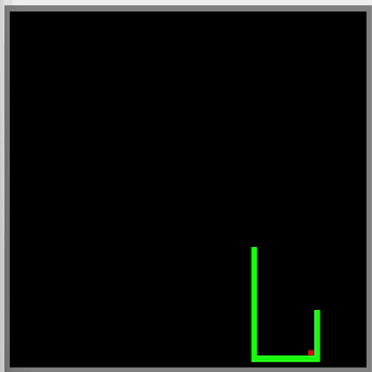

# Snake in MIPS Assembly

A complete Snake game written in MIPS assembly for the **MARS** simulator. The game draws to a memory-mapped bitmap display and reads the keyboard through memory-mapped I/O registers, the same way low-level software talks to hardware on a real embedded system.



## Features

- **64 × 64 playing field** drawn pixel by pixel, with a gray border wall, a green snake, and red food
- **Memory-mapped I/O** for both output (the bitmap display) and input (the keyboard's control and data registers), with no operating-system calls for graphics or controls
- **Circular buffer** holding up to 4,096 body segments, with power-of-two index masking for wrap-around
- **Collision detection by reading the screen:** the game checks the color of the pixel the head is about to enter, so walls, the snake's own body, and food are detected without a separate grid in memory
- **Food placement** at random empty cells, retrying until it finds a free spot
- **Speed increases** with every piece of food, from 100 ms per move down to a 40 ms limit
- **Pause, restart, and quit** controls, plus protection against reversing straight into the snake's own body
- **Game-over summary** printed to the console with the final score and length

## Controls

| Key | Action |
|---|---|
| `w` `a` `s` `d` | Move up, left, down, right |
| `p` | Pause / resume |
| `r` | Restart (after game over) |
| `q` | Quit (after game over) |

## How to run it

1. Open `snake.asm` in **MARS 4.5**.
2. Open **Tools → Bitmap Display** and set:
   - Unit width and height in pixels: **8**
   - Display width and height in pixels: **512**
   - Base address for display: **0x10008000 ($gp)**

   Then click **Connect to MIPS**.
3. Open **Tools → Keyboard and Display MMIO Simulator** and click **Connect to MIPS**.
4. Assemble (F3) and run (F5).
5. Click in the **lower text box** of the Keyboard and Display MMIO Simulator and use the keys above to play.

## How it works

### Memory-mapped display

The Bitmap Display reads its pixels directly from memory starting at `0x10008000`, with one 32-bit word per pixel holding its color. The game draws a cell at grid position (x, y) by storing a color at:

```
address = 0x10008000 + 4 × (y × 64 + x)
```

The same calculation, used with a load instead of a store, reads a cell's color back. Both are wrapped in the `draw_pixel` and `get_pixel` procedures.

### Memory-mapped keyboard

The keyboard simulator exposes two registers in memory:

| Address | Register | Use |
|---|---|---|
| `0xFFFF0000` | Receiver control | Bit 0 is set when a key is waiting |
| `0xFFFF0004` | Receiver data | The ASCII code of the key |

Every frame, `read_input` polls the control register. If a key is ready, it reads the data register and updates the direction. A key that would reverse the snake into itself is ignored.

### Snake body: a circular buffer

The body is stored as a queue of cell positions in a 4,096-word circular buffer. Each position is packed into a single word as `y × 64 + x`. Every move:

1. The new head position is added at `head_idx`.
2. Unless the snake is growing, the tail cell is erased from the screen and `tail_idx` advances.

Both indices wrap around with `index & 4095` instead of a slower comparison, which works because the buffer size is a power of two.

### Collision detection

Before drawing the new head, the game reads the color already on screen at that cell:

| Color found | Result |
|---|---|
| Gray (wall) or green (snake) | Game over |
| Red (food) | Score +1, snake grows by 3 segments, new food is placed |
| Black (empty) | Normal move |

Using the display memory as the game state keeps the code simple and avoids a separate grid in memory.

### Game loop and timing

Each frame reads input, moves the head, checks for collisions, updates the body, and then sleeps. The delay shortens by 5 ms for every point scored, starting at 100 ms. It's held at a minimum of 40 ms using a branchless `movn` instruction rather than a branch.

### Structure

| Procedure | Purpose |
|---|---|
| `main` / `game_loop` | Main loop: input, movement, collisions, growth, timing |
| `init_game` | Clears the screen, draws the border, resets all game state |
| `read_input` | Polls the keyboard registers and updates direction or pause |
| `spawn_food` | Places food at a random empty cell |
| `draw_border` | Draws the four walls |
| `draw_pixel` / `get_pixel` | Writes or reads one cell in display memory |

Procedures that call other procedures save `$ra` and any `$s` registers they use on the stack, following the MIPS calling convention.

## Files

| File | Description |
|---|---|
| `snake.asm` | Complete game source |
| `docs/demo.gif` | Gameplay recording |
